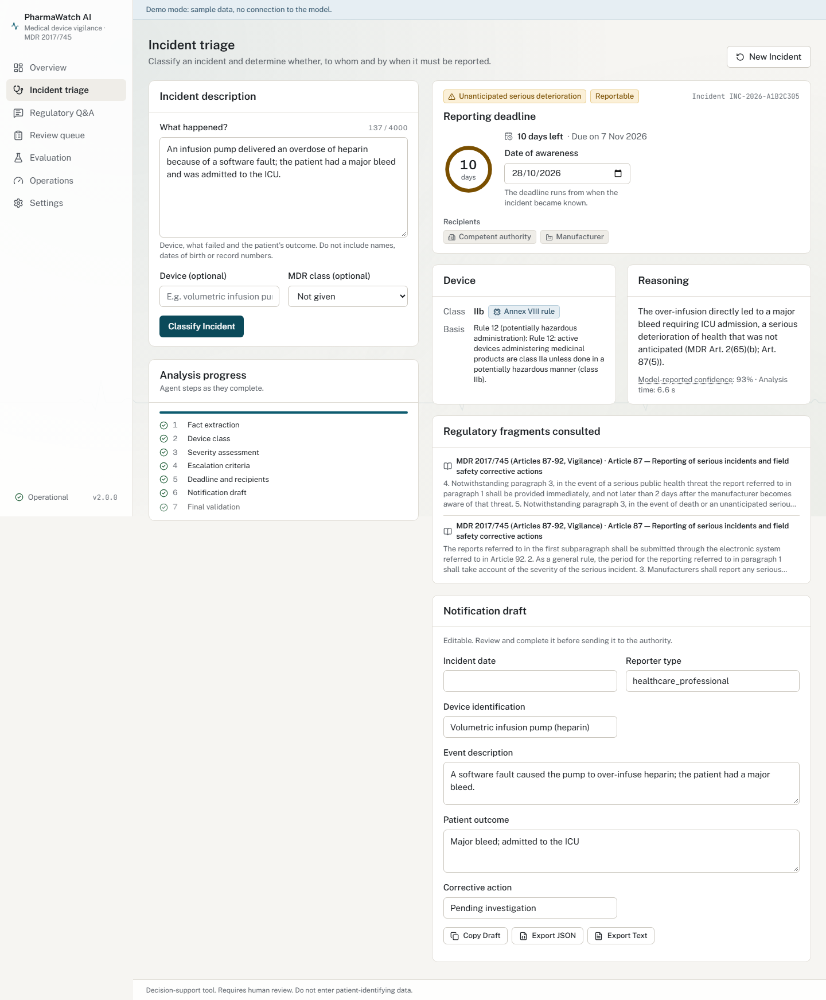
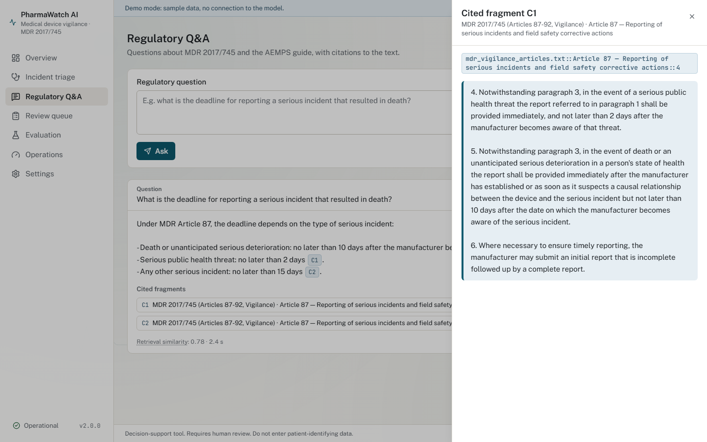
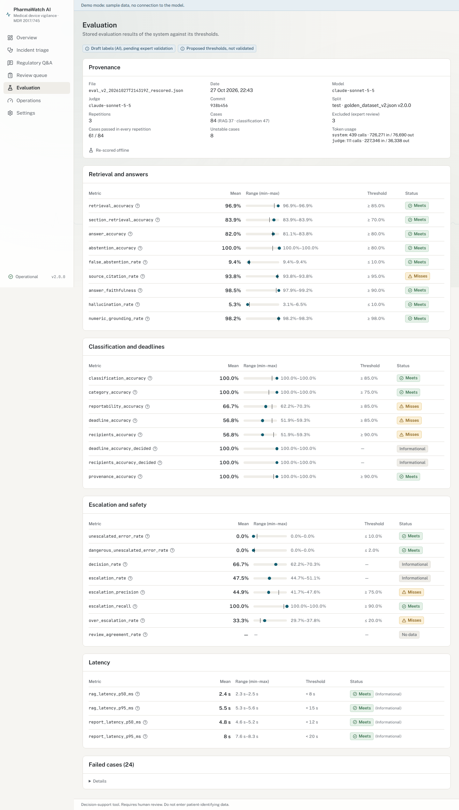
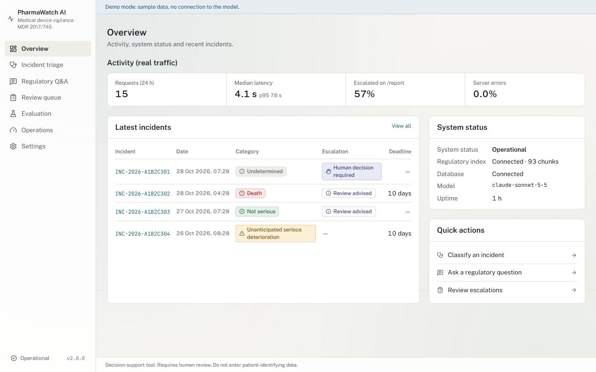
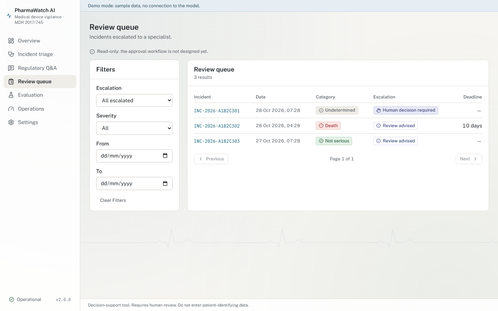
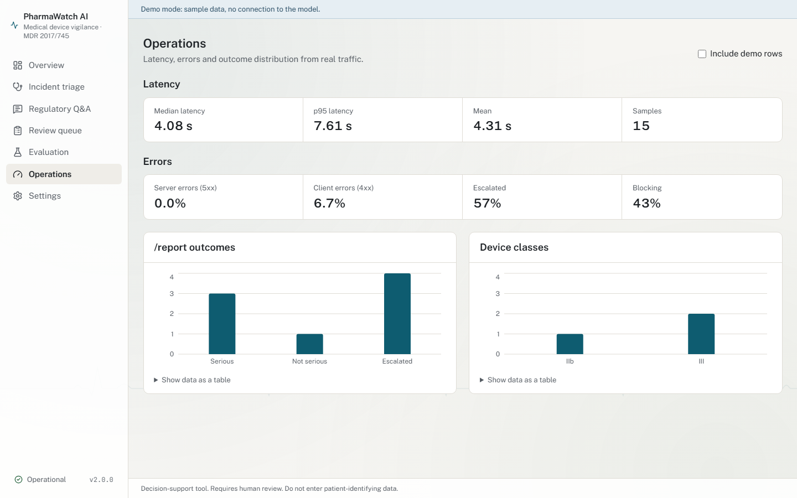
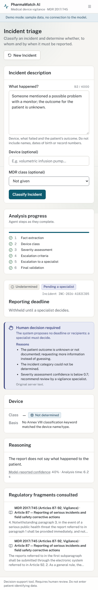
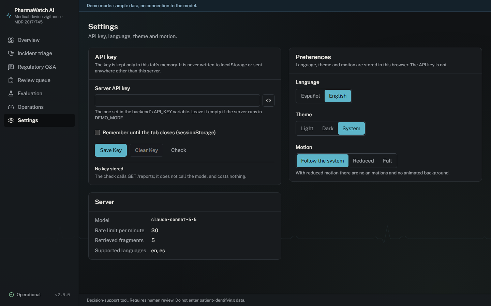
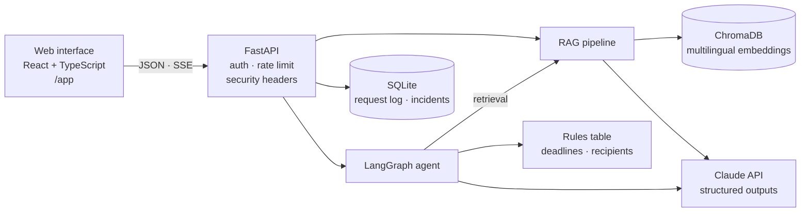
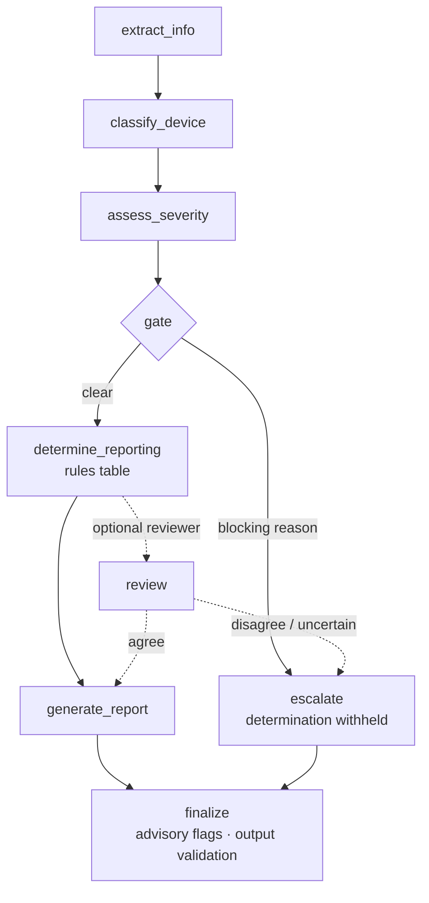

<div align="center">

# 🩺 PharmaWatch AI

### Decision support for medical device vigilance under EU MDR 2017/745

Regulatory Q&A with citations · incident triage with an explainable agent · honest evaluation

<br/>


*Biomedical Engineering Portfolio · Alonso Martín Díez · Universidad Europea de Madrid · 2026*

</div>

---

> [!IMPORTANT]
> **Decision-support prototype, not a medical device.** Every output requires review by a
> qualified vigilance professional. Do not enter patient-identifying data: descriptions are
> sent to a third-party model API. The evaluation labels are AI-written drafts pending expert
> validation, and the thresholds are proposed.

## 📌 Overview

Under Article 87 of Regulation (EU) 2017/745 (MDR), a manufacturer must report a serious
incident involving a medical device to the competent authority within deadlines that depend
on the type of incident: no later than **2 days** for a serious public health threat, **10
days** for a death or an unanticipated serious deterioration in a person's state of health,
and **15 days** for other serious incidents. Deciding which case applies — and who must be
notified — means reading the definitions in Article 2, the vigilance articles and, in Spain,
the AEMPS guidance, often under time pressure.

PharmaWatch AI helps with that reading:

- **Regulatory Q&A.** Questions in English or Spanish are answered from the indexed text of the
  MDR vigilance articles, Annex VIII and the AEMPS vigilance guidance, citing the exact
  fragments used. When the corpus does not answer, it abstains.
- **Incident triage.** A LangGraph agent extracts the facts from a free-text description,
  determines the device class and the incident category, and drafts the reporting
  determination. **Deadlines and recipients come from a rules table, not from the model.**
  When facts are missing or the category is in doubt, it withholds the determination and asks
  a human (blocking escalation); minor issues are flagged without withholding (advisory).

**Scope:** vigilance of medical devices under the MDR (mainly the manufacturer's obligations
in Article 87), with Spanish AEMPS guidance as national context. It does not cover medicinal
products (drug pharmacovigilance) or in vitro diagnostics.

## 🖥️ Interface

Screenshots of the production build in **mock mode** (scenario data in the browser, no model
calls), regenerated with Playwright.

| Incident triage | Regulatory Q&A |
|---|---|
|  |  |
| **Evaluation** | **Overview** |
|  |  |
| **Review queue** | **Operations** |
|  |  |
| **Blocking escalation (phone)** | **Settings (dark theme)** |
|  |  |

Seven screens in Spanish and English, light and dark themes, reduced-motion support, keyboard
navigation, and no serious or critical axe violations at phone, tablet and desktop widths.
Design system: [frontend/DESIGN.md](frontend/DESIGN.md).

## 🏗️ Architecture



The incident agent:



Details: [docs/architecture.md](docs/architecture.md).

## ✨ Features

| Area | What it does |
|---|---|
| 📚 Regulatory Q&A | Retrieval over MDR Art. 2(64)–(69), 87–89, 92, Annex VIII and the AEMPS guide; answers cite `[Cn]` fragments; abstains when the corpus does not answer; English and Spanish. |
| 🧭 Incident triage | Category, severity, device class with its provenance, reportability, deadline and recipients from a rules table; editable notification draft; export as JSON or text. |
| 🚦 Escalation | Blocking (determination withheld) for unknown outcome, missing device, contradictions, category doubt, death conflicts, unparseable output or low confidence; advisory flags otherwise. |
| 📡 Live agent steps | `POST /report/stream` streams the graph's real node events over SSE; the interface shows them as they happen. |
| 🧪 Evaluation | Dataset v2 (152 draft cases, frozen split), 3 repetitions with min–max, escalation precision / recall, faithfulness judge plus deterministic numeric grounding, offline re-scoring. |
| 📈 Operations | Request log with latency percentiles, 4xx / 5xx rates and outcome distributions; demo rows excluded by default. |
| 🔒 Safety by default | Endpoints disabled without an API key, rate limits, body-size limit, strict CSP, uniform errors, submitted text stored only as length and hash. |
| 🖥️ Web interface | Seven screens, ES / EN, dark mode, mock mode with no backend, served by FastAPI at `/app`. |

## 📊 Evaluation results

Golden dataset v2, **`test` split: 84 cases × 3 repetitions**, model `claude-sonnet-5-5`
(judge: same model), commit `938b456`, run on 2026-10-27, re-scored offline with the current
metric code. **Labels are AI-written drafts pending expert validation; thresholds are
proposed.** Full definitions and tables: [docs/evaluation.md](docs/evaluation.md).

| Metric | Mean | Min – max | Threshold | Status |
|---|---|---|---|---|
| `retrieval_accuracy` | 96.9 % | 96.9 % – 96.9 % | ≥ 85 % | ✅ |
| `answer_accuracy` | 82.0 % | 81.1 % – 83.8 % | ≥ 80 % | ✅ |
| `source_citation_rate` | 93.8 % | 93.8 % – 93.8 % | ≥ 95 % | ❌ |
| `answer_faithfulness` | 98.5 % | 97.9 % – 99.2 % | ≥ 90 % | ✅ |
| `hallucination_rate` | 5.3 % | 3.1 % – 6.5 % | ≤ 10 % | ✅ |
| `category_accuracy` | 100.0 % | 100.0 % – 100.0 % | ≥ 75 % | ✅ |
| `reportability_accuracy` | 66.7 % | 62.2 % – 70.3 % | ≥ 85 % | ❌ |
| `deadline_accuracy` | 56.8 % | 51.9 % – 59.3 % | ≥ 85 % | ❌ |
| `recipients_accuracy` | 56.8 % | 51.9 % – 59.3 % | ≥ 90 % | ❌ |
| `deadline_accuracy_decided` | 100.0 % | 100.0 % – 100.0 % | — | ℹ️ |
| `recipients_accuracy_decided` | 100.0 % | 100.0 % – 100.0 % | — | ℹ️ |
| `unescalated_error_rate` | 0.0 % | 0.0 % – 0.0 % | ≤ 10 % | ✅ |
| `dangerous_unescalated_error_rate` | 0.0 % | 0.0 % – 0.0 % | ≤ 2 % | ✅ |
| `escalation_recall` | 100.0 % | 100.0 % – 100.0 % | ≥ 90 % | ✅ |
| `escalation_precision` | 44.9 % | 41.7 % – 47.6 % | ≥ 75 % | ❌ |
| `over_escalation_rate` | 33.3 % | 29.7 % – 37.8 % | ≤ 20 % | ❌ |
| `report_latency_p95_ms` | 8.0 s | 7.6 s – 8.3 s | < 20 s | ℹ️ |

61 of 84 cases passed in all three repetitions; 8 were flaky.

**How to read it.** The system errs towards asking a human: no wrong determination reached the
user without a blocking escalation, and every case that needed a human was escalated. The cost
is over-escalation. Deadline, recipient and reportability accuracy count a withheld
determination as a miss; when the system did decide, deadlines and recipients were 100 %
correct. About a third of decidable cases were blocked, mostly because of doubt between
incident categories with different deadlines — by design — plus low model-reported
confidence and unknown outcomes. Proposed fixes are in
[docs/open_questions.md](docs/open_questions.md); none is applied.

### ⚠️ Limitations

- Labels written by an AI assistant from the same corpus; agreement with them is not expert
  validation.
- Proposed, not validated, thresholds.
- The judge is the same model family as the system.
- 84 synthetic test cases; min–max shows run-to-run variance, not a confidence interval.
- The optional reviewer node has not been evaluated (ablation pending).
- Latency measured on one developer machine.

## 🚀 Quick start

### 1. Interface only, mock mode (no backend, no API key, no cost)

```bash
cd frontend
npm ci
npm run dev:mock        # open http://localhost:5173
```

### 2. Full stack locally

```bash
python -m venv .venv
source .venv/bin/activate              # Windows: .venv\Scripts\activate
pip install -r requirements-dev.txt -c requirements.lock
cp .env.example .env                   # fill in the variables below
python scripts/ingest_documents.py     # index the corpus (downloads the embedding model once)

cd frontend && npm ci && npm run build && cd ..
uvicorn src.api.main:app               # http://localhost:8000/app  ·  API docs at /docs
```

| Variable | Purpose |
|---|---|
| `ANTHROPIC_API_KEY` | Model API key; needed for `/ask` and `/report` (not for tests or mock mode). |
| `API_KEY` | Key the clients send in `X-API-Key`; enter it in **Settings** in the interface. |
| `DEMO_MODE` | With `API_KEY` empty, `true` opens `/ask` and `/report` for a local demo. Without either, those endpoints answer 403. |
| `STORE_INPUT_TEXT` | Keep submitted text in the request log (default: only length and hash). |

All variables, with defaults: [.env.example](.env.example) and
[docs/development.md](docs/development.md).

### 3. Docker

```bash
docker compose up --build              # http://localhost:8000/app
```

Pass `ANTHROPIC_API_KEY` and either `API_KEY` or `DEMO_MODE=true` through the environment.
The Docker build has not been verified in the author's environment.

### Tests (no model calls)

```bash
pytest
cd frontend && npm test && npm run test:e2e
```

> [!WARNING]
> **Running the evaluation costs money.** `scripts/run_evaluation.py` and `POST /evaluate`
> call the model for every case and repetition (the stored v2 run made 550 calls). Re-scoring
> stored results with `scripts/rescore_evaluation.py` is free.

## 🔌 API reference

| Method | Path | Purpose |
|---|---|---|
| GET | `/health` | Status of the vector store and database, model, version. |
| POST | `/ask` | Regulatory question → cited answer. |
| POST | `/report` | Incident description → reporting determination or escalation. |
| POST | `/report/stream` | Same, with the agent's steps as Server-Sent Events. |
| GET | `/reports`, `/reports/{id}` | Stored incident results (paginated, filters). |
| GET | `/metrics` | Operational metrics. |
| GET | `/evaluations/latest` | Latest stored evaluation (read-only). |
| POST | `/evaluate` | Run the evaluation (costly; always needs `API_KEY`). |
| GET | `/config` | Non-secret capabilities. |

Errors use one envelope, `{"code", "message", "details"}`, with 401, 403, 404, 409, 413, 422,
429 and 503 documented in [docs/api_reference.md](docs/api_reference.md).

## 🔒 Security

- Cost-bearing endpoints are disabled unless `API_KEY` or `DEMO_MODE` is configured; keys
  compared in constant time; per-IP rate limit; body-size limit before parsing.
- Strict `Content-Security-Policy: default-src 'self'` and standard security headers on every
  response; uniform errors that never echo input or stack traces.
- User text is delimited as untrusted data in prompts, model output is schema-constrained, and
  deadlines come from the rules table; a prompt-injection pattern screen flags (does not block)
  suspicious text.
- The interface keeps the API key in memory (optionally `sessionStorage`), never in
  `localStorage`.

**Limits:** a single shared key (no users, roles or audit trail), no de-identification of
submitted text, no encryption at rest, in-process rate limiting, no external security review.
Details: [docs/security.md](docs/security.md).

## 📁 Project structure

```text
pharmawatch-ai/
├── src/
│   ├── api/              # FastAPI app, routes, schemas, middleware, auth, /app serving
│   ├── agent/            # LangGraph graph, nodes, LLM client, guardrails, regulatory rules, reviewer
│   ├── rag/              # ingestion, embeddings, Chroma vector store, retriever
│   ├── db/               # SQLAlchemy models, repository, operational metrics
│   ├── evaluation/       # dataset, harness, metrics, judge, reporter
│   └── config.py         # settings from environment / .env
├── frontend/
│   ├── src/              # React app: pages, components, API client, i18n, mocks
│   ├── e2e/              # Playwright: smoke, accessibility, screenshots
│   ├── e2e-live/         # smoke against a real backend (no model calls)
│   └── DESIGN.md         # design system
├── data/
│   ├── regulations/      # MDR and AEMPS corpus (plain text)
│   ├── classification_rules.json
│   ├── golden_dataset.json       # v1 (30 cases, reference only)
│   └── golden_dataset_v2.json    # v2 (152 draft-AI cases)
├── config/eval_thresholds.json   # proposed thresholds
├── scripts/              # ingest, evaluation, re-scoring, OpenAPI export, docs check
├── tests/                # pytest suite (scripted LLM, isolated data)
├── static/               # legacy demo page (/static)
├── docs/                 # architecture, API, evaluation, security, development, open questions, changelog
├── Dockerfile · docker-compose.yml
└── requirements.txt · requirements-dev.txt · requirements.lock
```

## 🧪 Testing

| Suite | Tests | Notes |
|---|---|---|
| Backend — pytest | 242 | 237 run by default; 5 live tests are opt-in (`--live` and a key). Scripted LLM, isolated temporary database and vector store. |
| Frontend — Vitest | 52 | Screens, API client, key storage, retry policy, WCAG contrast of the design tokens. |
| End-to-end — Playwright | 47 | 39 by default: 7 screens × 3 widths with axe, dark mode, keyboard flow, triage and Q&A flows. 8 regenerate the screenshots on demand. |
| Live smoke — Playwright | 3 | Production build served by a real backend; never submits `/ask` or `/report`. |

The documentation figures are checked against the stored results by
`python scripts/check_docs.py`. CI configuration exists in `.github/workflows/ci.yml` but has
not been run on a remote runner yet.

## 🗺️ Roadmap

- [ ] **Expert validation** of the dataset labels, starting with the 6 cases flagged for review.
- [ ] **Reviewer ablation**: measure the optional reviewer node against the stored baseline.
- [ ] **Reduce over-escalation** with the proposed changes, measured on `dev` first.
- [ ] **Human review workflow**: approve / correct / submit with user identity and audit trail.
- [ ] **Stable escalation reason codes** in the API, translated by the interface.
- [ ] **Deployment** with persistent storage, secrets management and shared rate limiting.
- [ ] **More languages** for the interface and the corpus.

## 📚 References

- Regulation (EU) 2017/745 on medical devices (MDR), Official Journal L 117, 5.5.2017,
  CELEX 32017R0745 — Articles 2, 87–89 and 92; Annex VIII.
- AEMPS — [Vigilancia de productos sanitarios](https://www.aemps.gob.es/productos-sanitarios/vigilancia_productossanitarios/).
- AEMPS — [Información sobre el sistema de vigilancia de productos sanitarios y sobre las funciones del responsable de vigilancia de los centros sanitarios](https://www.aemps.gob.es/productos-sanitarios/vigilancia_productossanitarios/informacion-sobre-el-sistema-de-vigilancia-de-productos-sanitarios-y-sobre-las-funciones-del-responsable-de-vigilancia-de-los-centros-sanitarios/).
- European Commission — [Guidance: MDCG endorsed documents and other guidance](https://health.ec.europa.eu/medical-devices-sector/new-regulations/guidance-mdcg-endorsed-documents-and-other-guidance_en)
  (lists MDCG 2023-3, *Questions and Answers on vigilance terms and concepts*; not part of the
  indexed corpus).

## 📄 License

MIT — see [LICENSE](LICENSE). The regulatory texts in `data/regulations/` remain subject to
their publishers' terms.

## 👤 Author

**Alonso Martín Díez** — Biomedical Engineering, Universidad Europea de Madrid

Repository: `<REPO_URL>`

<div align="center">

*Biomedical Engineering Portfolio · Alonso Martín Díez · Universidad Europea de Madrid · 2026*

</div>
