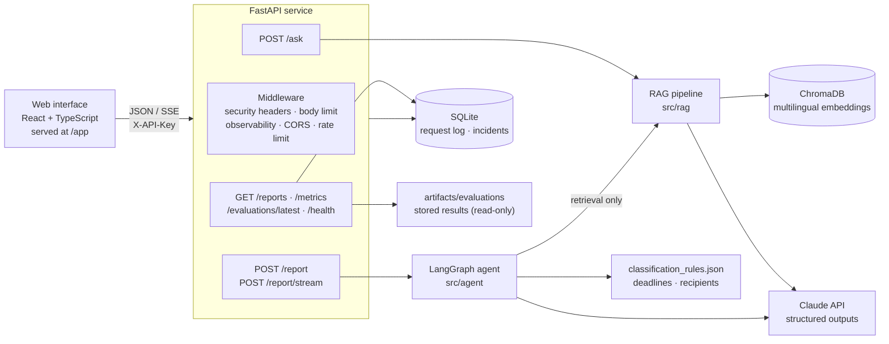
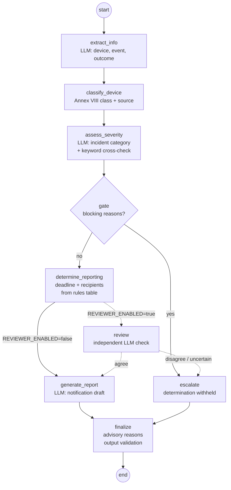

# Architecture

PharmaWatch AI is one FastAPI service with two AI features — regulatory question answering
(RAG) and an incident-classification agent (LangGraph) — plus SQLite persistence and a React
web interface served by the same service.

## System overview

| Component | Code | Notes |
|---|---|---|
| API | `src/api/` | Routes, Pydantic v2 schemas, uniform error envelope, middleware, auth dependencies. |
| RAG | `src/rag/` | Ingestion (chunk 800 / overlap 200), embeddings, Chroma vector store, retriever (top-k 5), answer generation with `[Cn]` citations. |
| Agent | `src/agent/` | LangGraph `StateGraph`, nodes, LLM client, guardrails, regulatory lookups, optional reviewer. |
| Persistence | `src/db/` | SQLAlchemy models, additive migrations, repository, operational metrics. |
| Evaluation | `src/evaluation/` | Dataset loader, harness with repetitions, metrics, LLM judge, reporter. |
| Web interface | `frontend/` | React 19, Vite, Tailwind, TanStack Query, typed client generated from the OpenAPI schema. Design system in [frontend/DESIGN.md](../frontend/DESIGN.md). |

## Corpus

Three plain-text files in `data/regulations/`, indexed into Chroma by
`scripts/ingest_documents.py`:

| File | Content |
|---|---|
| `mdr_vigilance_articles.txt` | Regulation (EU) 2017/745 (MDR): Article 2 points 64–69, Articles 87, 88, 89 and 92. |
| `mdr_annex_classification_rules.txt` | MDR Annex VIII, classification rules (Chapters I–III). |
| `aemps_vigilancia_guia.txt` | Spanish AEMPS guidance on the medical device vigilance system (in Spanish). |

The embedding model is `paraphrase-multilingual-MiniLM-L12-v2`, so Spanish and English
questions retrieve from all three files. The collection records the model it was built with;
opening it with a different model raises an error instead of returning poor results.

## Incident-classification agent

- **The model never chooses a deadline.** It returns a structured incident category; the
  deadline (2, 10 or 15 days) and the recipients come from `data/classification_rules.json`
  via `src/agent/regulatory.py`.
- **Blocking escalation** (the determination is withheld and a human must decide) when the
  patient outcome is unknown, the device is missing, the facts contradict each other, the
  model is in doubt between categories with different obligations, a death signal conflicts
  with the category, the model output cannot be parsed, or confidence is low.
- **Advisory escalation** (the determination is kept and flagged) for issues that do not change
  the obligation, e.g. an undetermined device class or a flagged prompt-injection pattern.
- **Optional reviewer** (`REVIEWER_ENABLED=true`): a second model call sees the description,
  the principal decision without its confidence, and the regulatory fragments. Anything other
  than `agree` becomes a blocking escalation; the principal decision is kept in `review`. Its
  effect has not been measured (see [evaluation.md](evaluation.md)).
- `POST /report/stream` streams one `step` event per node actually executed, then the result,
  over Server-Sent Events. The web interface shows these steps as they arrive; it never
  simulates them.

## LLM client

`src/agent/llm.py` is the single place that constructs the Anthropic client. It uses
structured outputs (JSON schema), explicit timeouts and retries, and typed errors: an outage
or an unusable response becomes HTTP 503 with a stable code (`llm_unavailable`,
`llm_bad_output`) and never a stack trace. Tests inject a scripted client (`tests/fakes.py`), so
the test suite makes no model calls.

## Persistence

SQLite (`DB_PATH`, default `data/pharmawatch.db`) holds:

- **Request log** for `/ask`, `/report`, `/report/stream` and `/evaluate`: status, latency,
  error code and, by default, only the length and SHA-256 of the submitted text
  (`STORE_INPUT_TEXT=false`). Rows seeded by `scripts/seed_db.py` are marked `source='demo'`
  and excluded from `/metrics` unless `include_demo=true`.
- **Incidents**: the structured result of each classification (no free-text narrative), served
  read-only by `GET /reports` and `GET /reports/{id}`.

Schema changes are additive migrations applied on start-up.

## Web interface

Seven screens — Overview, Incident triage, Regulatory Q&A, Review queue (read-only),
Evaluation, Operations, Settings — in Spanish and English. It runs three ways:

| Mode | Command | Data |
|---|---|---|
| Mock | `npm run dev:mock` | Mock Service Worker answers in the browser with scenario data; no backend, no model calls. |
| Development | `npm run dev` | Vite proxies `/api/*` to the backend on port 8000. |
| Production | `npm run build` | `frontend/dist` is served by FastAPI at `/app` (`src/api/frontend.py`). |

The API key is kept in memory (optionally `sessionStorage` until the tab closes), never in
`localStorage`. See [frontend/DESIGN.md](../frontend/DESIGN.md) for the design system.
